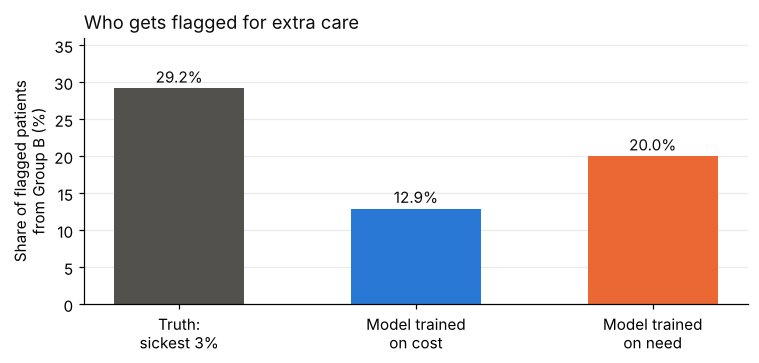

# When cost stands in for need

A short, reproducible example of how a **proxy label** can build inequity into a model, even when no sensitive variable is used.

## The point in one table

20,000 simulated patients. Group B has the same illness burden as Group A but uses about 35% less healthcare, because of access barriers. A programme offers extra care to the top 3% of patients by model score.

| Selection | Share from Group B | Mean conditions of flagged, Group A | Mean conditions of flagged, Group B |
| --- | --- | --- | --- |
| Truth: sickest 3% | 29.2% | 5.55 | 5.54 |
| Model trained on cost | 12.9% | 4.78 | 5.52 |
| Model trained on need | 20.0% | 4.91 | 5.31 |

The cost model flags less than half the Group B patients it should, and the ones it does flag are sicker than their Group A peers. Changing only the label helps, but the inputs still carry part of the access gap.

## Inspired by

Obermeyer, Z., Powers, B., Vogeli, C. and Mullainathan, S. (2019) 'Dissecting racial bias in an algorithm used to manage the health of populations', *Science*, 366(6464), pp. 447-453. [PubMed](https://pubmed.ncbi.nlm.nih.gov/31649194/)

## Data and assumptions

All data is **synthetic**. "Group A" and "Group B" are abstract labels, and the spending gap and diagnosis-recording rates are illustrative assumptions. This is not a reproduction of the original study.

## Author

Yuktha, research ethics and health data science. www.linkedin.com/in/yukthashreenivasan
